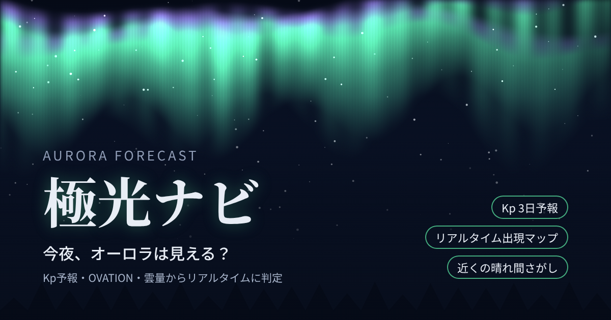
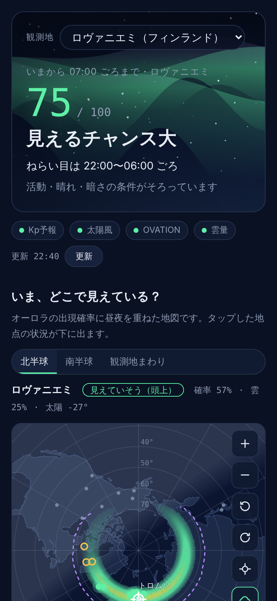
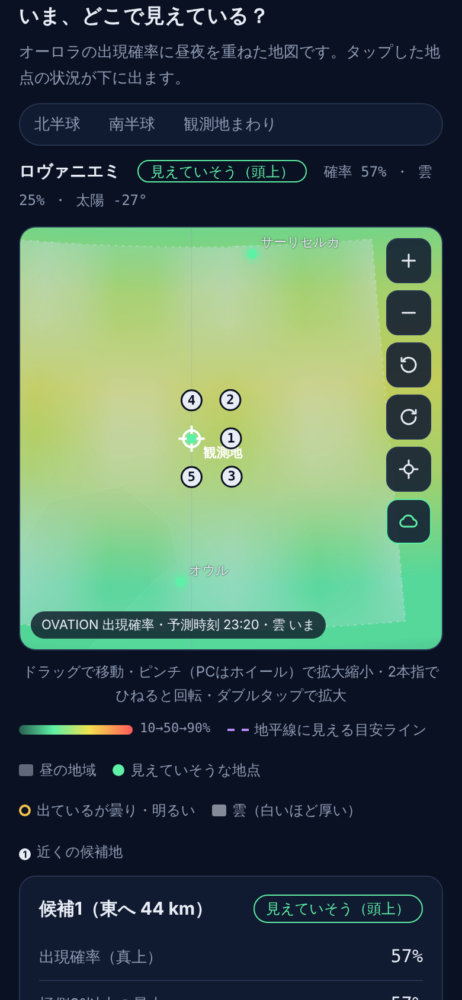

# 極光ナビ — 今夜、オーロラは見える？

**▶ アプリを開く：https://gaaasuu2013-prog.github.io/aurora/**

極光ナビは、オーロラが「今夜その場所で見えるか」を予測する無料のWebアプリです。インストールやアカウント登録は不要で、スマホのブラウザですぐに使えます。

NOAA（米国海洋大気庁）の宇宙天気データと雲量予報をもとに、見えやすさを0〜100の目安で表示します。あわせて、オーロラがいまどこに出ているかを示すリアルタイムの地図と、近くで晴れている場所の候補も出します。

| 今夜の見込み | リアルタイム地図と近くの候補地 |
|---|---|
|  |  |

※ 画面はサンプルデータによる表示例です。

## できること

- **今夜の見えやすさ（0〜100）**：磁気活動・晴れ・暗さ・月明かりを組み合わせて判定し、「ねらい目の時間帯」と何がネックかを表示します。
- **48時間の見込みグラフ**：1時間ごとのスコアです。棒をタップすると、Kp・雲量・太陽高度・月の詳細が見られます。
- **リアルタイム出現マップ**：NOAA OVATIONの出現確率（30〜60分先）に、昼夜・雲・「地平線に見える目安ライン」を重ねて表示します。ドラッグ、ピンチ、回転で自由に操作できます。
- **近くで見えやすい場所**：観測地のまわり約200 kmの雲量予報から、いま〜3時間後に晴れていて見えやすい場所を5か所まで提案します。Googleマップですぐに道案内できます。
- **世界の代表的な観測地34か所の「いま」**：フィンランド、ノルウェー、アイスランド、カナダ、アラスカ、北海道、ニュージーランドなどです。
- **Kp指数 3日予報**、太陽風（Bz・速度）の現在値。

## 使い方

1. 上のリンクを開き、観測地を選びます。画面右上の「日本語 / EN」で英語表示にも切り替えられます。プリセットのほか、現在地や緯度・経度の入力にも対応しています。
2. スマホのホーム画面に追加すると、アプリのように起動できます。
   - iPhone（Safari）：共有ボタン →「ホーム画面に追加」
   - Android（Chrome）：メニュー →「アプリをインストール」または「ホーム画面に追加」
3. データは開いている間、自動で更新されます（OVATIONは5分ごと、そのほかは10分ごと）。

## データの出典

- 宇宙天気（Kp予報・太陽風・OVATION）：[NOAA Space Weather Prediction Center](https://www.swpc.noaa.gov/)
- 雲量予報：[Open-Meteo](https://open-meteo.com/)（[CC BY 4.0](https://creativecommons.org/licenses/by/4.0/)）
- 地図の陸地：[Natural Earth](https://www.naturalearthdata.com/)（パブリックドメイン）
- 太陽・月の位置と地磁気緯度：アプリ内で計算しています。

## ご注意

- スコアは確率ではなく、条件の良し悪しを比べるための目安です。オーロラは数十分単位で急に変わります。
- 夜間に移動するときは、路面の凍結や寒さに十分ご注意ください。私有地や立入禁止の場所には入らないでください。

## しくみ

1つのHTMLファイルだけで動いており、サーバーは使っていません。各データは、利用者のブラウザがNOAAとOpen-Meteoから直接取得します。位置情報や選んだ観測地は端末の中だけで使われ、どこにも送信されません。アクセス数の集計には [GoatCounter](https://www.goatcounter.com/) を使っています（Cookieは使わず、個人を特定する情報も保存しません）。

ご意見や不具合の報告は [Issues](../../issues) からどうぞ。

---

## Kyokkō Navi — Will I see the aurora tonight?

**Open the app: https://gaaasuu2013-prog.github.io/aurora/**

A free web app, in English and Japanese, that estimates how likely you are to see the northern or southern lights tonight. It rates your location from 0 to 100 using NOAA's Kp forecast, real-time solar wind and the OVATION aurora model, together with cloud forecasts, darkness and moonlight.

- Live aurora map (NOAA OVATION) with day/night, clouds and a "view line" for seeing aurora low on the horizon
- Nearby clear-sky finder: the best spots within about 200 km, now or in up to 3 hours, with Google Maps links
- Status of 34 well-known aurora destinations, a 48-hour outlook and a 3-day Kp forecast
- No sign-up and no server. Your location never leaves your device.

Data: NOAA SWPC, Open-Meteo (CC BY 4.0), Natural Earth. The score is a guide for comparing conditions, not a probability.
